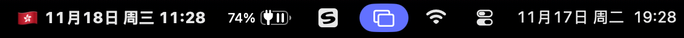

# MoreClock

[English](README.md) · [简体中文](README.zh-CN.md) · [繁體中文](README.zh-Hant.md) · [日本語](README.ja.md) · [한국어](README.ko.md) · [Deutsch](README.de.md) · [Français](README.fr.md) · [Español](README.es.md) · [Italiano](README.it.md) · [Português (Brasil)](README.pt-BR.md) · [Русский](README.ru.md) · [العربية](README.ar.md) · [فارسی](README.fa.md)

MoreClock muestra la hora de varias zonas horarias en la barra de menús de macOS. Cada reloj tiene su propio elemento en la barra.

## Instalación

[Descargar MoreClock para macOS](https://github.com/binarrii/MoreClock/releases/latest). La app universal requiere macOS 26 o posterior y funciona en Mac con chip de Apple o procesador Intel.

1. Cierra MoreClock si está abierto y abre el archivo DMG descargado.
2. Arrastra `MoreClock.app` a la carpeta Aplicaciones y ábrela desde allí.
3. Expulsa la imagen de disco.

La app publicada tiene una firma ad hoc y no ha pasado la notarización de Apple. macOS puede bloquear la primera apertura. [Guía de Apple para abrir apps](https://support.apple.com/es-es/102445)

## Configurar los relojes

- Busca un lugar, una zona horaria o un desfase respecto a UTC. Personaliza el nombre y el prefijo de cada reloj. Si el prefijo está vacío, MoreClock añade la bandera del país o región cuando está disponible.
- Elige si quieres mostrar la fecha, el día de la semana, ambos o ninguno. Los segundos y la negrita son opcionales. El formato de 12 o 24 horas sigue los ajustes del sistema.
- El menú de cada reloj muestra la fecha completa, el desfase UTC y la diferencia con la hora local. Desde ahí también puedes copiar la hora u ocultar el reloj.
- Mantén pulsada la tecla ⌘ al arrastrar para cambiar el orden. Arrastra un reloj fuera de la barra para ocultarlo.
- MoreClock no aparece en el Dock. Abre Ajustes desde el menú de un reloj o vuelve a abrir la app desde Finder o Spotlight.
- En General puedes elegir el idioma de la app y abrirla al iniciar sesión. El idioma del sistema sigue los ajustes de macOS. Consulta la versión en Acerca de.
- Atajos permite añadir, eliminar, mostrar, ocultar y configurar relojes, además de consultar su hora.

## Actualizaciones y desarrollo

Si actualizas desde la versión 0.1.1, se conservan tus ajustes. Para actualizar desde la versión 0.1.0 y conservarlos, usa la herramienta de migración. [Guía de migración](README.md#upgrading-from-v010)

Consulta la documentación detallada en inglés para [compilar la app](README.md#build-and-run), [ejecutar pruebas](README.md#tests) y [trabajar con las traducciones](README.md#localization).
