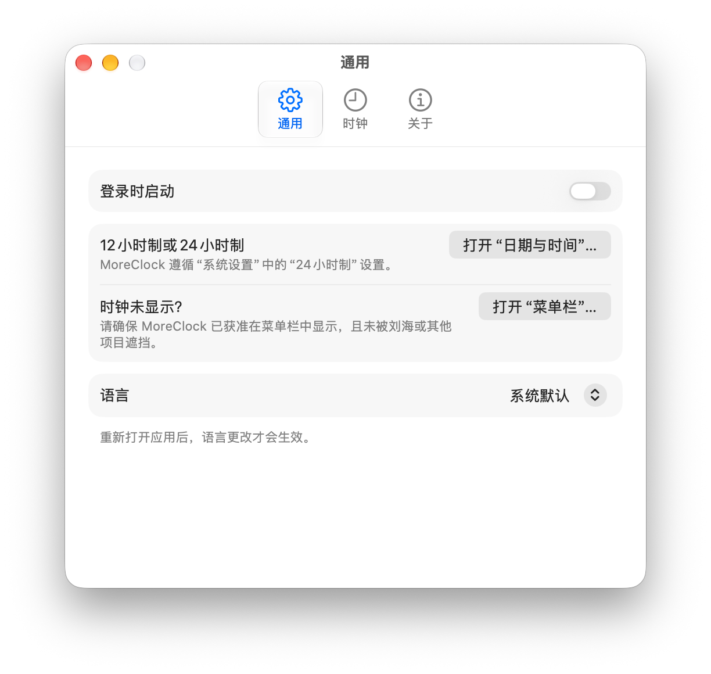
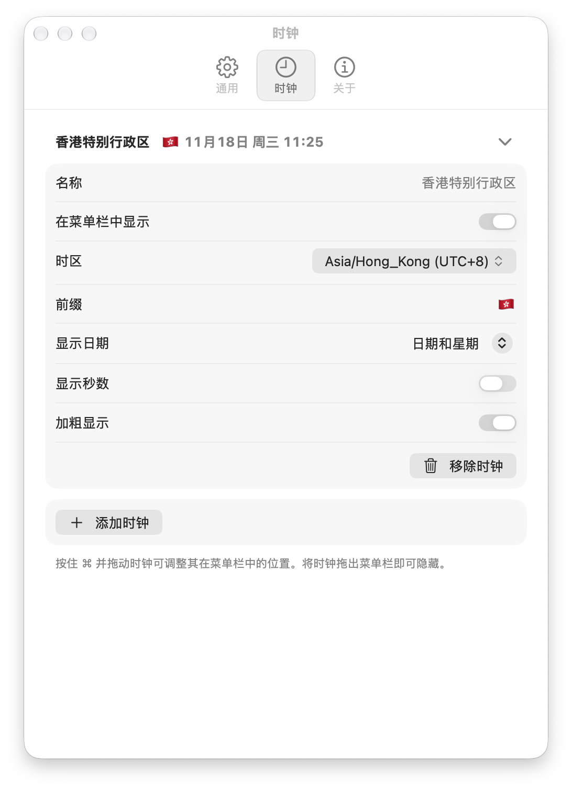

# MoreClock

[English](README.md) · [简体中文](README.zh-CN.md) · [繁體中文](README.zh-Hant.md) · [日本語](README.ja.md) · [한국어](README.ko.md) · [Deutsch](README.de.md) · [Français](README.fr.md) · [Español](README.es.md) · [Italiano](README.it.md) · [Português (Brasil)](README.pt-BR.md) · [Русский](README.ru.md) · [العربية](README.ar.md) · [فارسی](README.fa.md)

Extra clocks for the macOS menu bar, one menu bar item per time zone.

## Screenshots


<p>
  
  
</p>

## Features

- Any number of clocks. Each has a name, its own time zone, prefix (such as a flag emoji or "SF"), optional seconds, optional bold text, and an optional date: weekday, date, or both ("Tue", "Nov 17", "Tue, Nov 17").
- The date is formatted for the user's locale and calendar, and uses each clock's own time zone. A Honolulu clock can show a different day from a Tokyo clock.
- **Names:** a clock's name defaults to the place picked in the search ("Kyoto"), otherwise the time zone's city ("Tokyo") or offset ("UTC+5"). You can type your own ("Mom", "Berlin office"). Names appear in Settings, the clock's menu and Shortcuts; the menu bar shows the prefix, date and time.
- **Default prefix:** selecting a city or time zone fills an empty Prefix with the matching country or region flag. Your existing text or emoji is preserved. UTC and fixed offsets have no default flag.
- Follows the system 12/24-hour setting.
- Updates just after each minute boundary. A clock with seconds on ticks every second.
- Time zone picker:
  - offline matches by city, identifier, zone name ("Pacific Time") or offset ("UTC+5:30")
  - MapKit place search ("Tokyo", "Norway")
  - Hong Kong and Macau retain `Asia/Hong_Kong` and `Asia/Macau` even when Maps reports their region as `CN` and zone as `Asia/Shanghai`. Earlier saved clocks with that exact city/zone mismatch are repaired on launch, preserving the other settings.
  - Other single-zone regions use their own IANA identifier; multi-zone regions keep Maps’ coordinate-based result.
- Each clock's menu shows the full date, the UTC offset, the difference from local time, Copy Time and Hide This Clock.
- ⌘-drag to reorder clocks. Drag a clock out of the menu bar to hide it.
- **Settings:** three toolbar tabs: General (launch at login, language and system settings links), Clocks, and About (version, build, commit, build time and GitHub link). The selected tab is remembered. Each clock has a collapsible section (the first is expanded). Removing a clock asks for confirmation.
- Shortcuts actions: Add, Remove, Show/Hide, Set Name, Set/Get Time Zone, Set Prefix, Set Date Display, Get Time.
- Localized into English, Simplified and Traditional Chinese, Japanese, Korean, German, French, Spanish, Italian, Brazilian Portuguese, Russian, Arabic and Persian, including right-to-left layout for Arabic and Persian.
- Launch at login through `SMAppService`.

## Requirements

- macOS 26 or later
- Xcode 26 or later. Built and tested with Xcode 27.1.
- [XcodeGen](https://github.com/yonaskolb/XcodeGen) (`brew install xcodegen`). The `.xcodeproj` is generated from `project.yml`, so edit `project.yml` and regenerate rather than changing project settings in Xcode.

## Build and run

```bash
xcodegen generate
```

```bash
open MoreClock.xcodeproj
```

Or from the command line:

```bash
xcodebuild -project MoreClock.xcodeproj -scheme MoreClock -derivedDataPath build/DerivedData build
```

```bash
open build/DerivedData/Build/Products/Debug/MoreClock.app
```

For a release build, use the script. It builds the universal app and records the commit (marked `-dirty` for uncommitted changes) and build time shown in Settings › About. Other builds show only the version and build number.

```bash
Scripts/build-release.sh
```

The app has no Dock icon. On first launch it opens Settings. Open the app again from Finder or Spotlight to show Settings at any time, which is the way back if every clock is hidden.

If a clock doesn't appear, the notch or other items may be covering it, or macOS may be hiding it. Check **System Settings › Menu Bar** (on macOS 26).

## Upgrading from v0.1.0

Version 0.1.1 uses the Skyviiew application identity. macOS therefore gives it a separate preferences domain and sandbox container.

To keep your clocks and app language, keep a copy of the previous MoreClock app before replacing it. Quit all copies of MoreClock, then run the settings-transfer helper with the previous app and the new app as arguments:

```bash
bash Scripts/migrate-settings.sh "/path/to/previous/MoreClock.app" "/Applications/MoreClock.app"
```

The DMG also includes this helper as `Migrate Settings.sh`. It initializes the new container through macOS, backs up preferences inside the previous app’s private data, and copies settings without deleting the previous preferences. It refuses to overwrite different clocks already configured in the new app. If the app was already replaced, the previous release’s mounted DMG can supply the previous app path.

Enable Launch at login again if you used it. Existing Shortcuts may need to be updated to use the new app identity.

## Tests

The logic lives in the `MoreClockKit` package and is tested with Swift Testing:

```bash
swift test --package-path Packages/MoreClockKit
```

The Xcode scheme also runs these tests (⌘U, or `xcodebuild … test -destination 'platform=macOS'`).

## Localization

- **Language control:** Settings › General › Language uses the native per-app `AppleLanguages` preference, shared with macOS System Settings. System Default removes the app override and follows the system language. Choose Relaunch Now to apply a change; Settings opens again in the new language. Changes made externally are reflected when MoreClock becomes active.
- **Catalogs:** strings live in two String Catalogs:
  - `MoreClock/Resources/Localizable.xcstrings` for the UI, menus and Shortcuts actions.
  - `MoreClock/Resources/AppShortcuts.xcstrings` for the Siri and Spotlight phrases. Every phrase must contain `${applicationName}`.
- **Adding a string:** use a string literal in SwiftUI, or `String(localized:)` / `LocalizedStringResource` elsewhere. Then add the key to the catalog, either in Xcode or by building, which extracts new keys.
- **Formatting:** dates, times and durations come from Foundation format styles, so they follow the user's locale, numbering system and calendar. Persian shows Solar Hijri dates with Persian digits. Arabic in Saudi Arabia shows Umm al-Qura dates.
- **Literal inputs:** in the Shortcuts descriptions, `System`, IANA identifiers and `UTC+5:30` stay in English on purpose. They are the literal values the actions accept.
- **Testing a language** without changing the system language:

  ```bash
  open build/DerivedData/Build/Products/Debug/MoreClock.app --args -AppleLanguages '(ar)'
  ```

## App icon

- **File:** `MoreClock/Resources/AppIcon.icon` is an Icon Composer file: three Liquid Glass clock faces on an icy gradient.
- **Looks:** it adapts to the macOS 26 Default, Dark, Tinted and Clear appearances. You can open and tweak it in Icon Composer (inside Xcode).
- **Regenerating:** the layer artwork is drawn in code. Regenerate the layers and the `Design/AppIcon/preview.png` sheet with:

  ```bash
  ./Design/AppIcon/render.sh
  ```

## Layout

```
project.yml                 XcodeGen spec (targets, Info.plist keys, entitlements, scheme)
Packages/MoreClockKit/      Pure logic + tests
  ClockConfig.swift         Clock model (Codable, tolerant decoding) and TimeZoneSelection
  ClockStore.swift          @Observable store, JSON in UserDefaults "clocks"
  ClockFormatter.swift      12/24h-aware titles, optional date part, long date line, offset differences
  TimeZoneParsing.swift     "UTC+5:30" / identifiers / abbreviations, labels, offline search
MoreClock/
  App/                      AppKit entry point, app delegate, hidden main menu (for ⌘C/⌘V)
  MenuBar/                  ClockTicker (aligned timers) and StatusItemController (one item per clock)
  Settings/                 Settings window (SwiftUI Form), launch at login
  TimeZonePicker/           Picker popover and MapKit search
  Intents/                  App Intents, ClockEntity and App Shortcuts
  Resources/                String Catalogs (Localizable, AppShortcuts), AppIcon.icon
Design/AppIcon/             Icon layer generator (layers.swift), render + preview scripts
```

## Before shipping

- **Application identity:** the bundle identifier is `com.skyviiew.MoreClock`, configured in `project.yml`. Preferences, sandbox storage, App Intents, and per-app language settings use this identity.
- **Signing:** local and GitHub builds use ad-hoc signing (`CODE_SIGN_IDENTITY: "-"`). Developer ID signing and Apple notarization require the appropriate signing certificate and credentials.
- **Place search:** the app is sandboxed without `com.apple.security.network.client`. Check that place search works in a signed build. If it doesn't, add that entitlement in `project.yml`.
- **Translations:** a native speaker should review them before release. They were machine-drafted and machine-reviewed.
