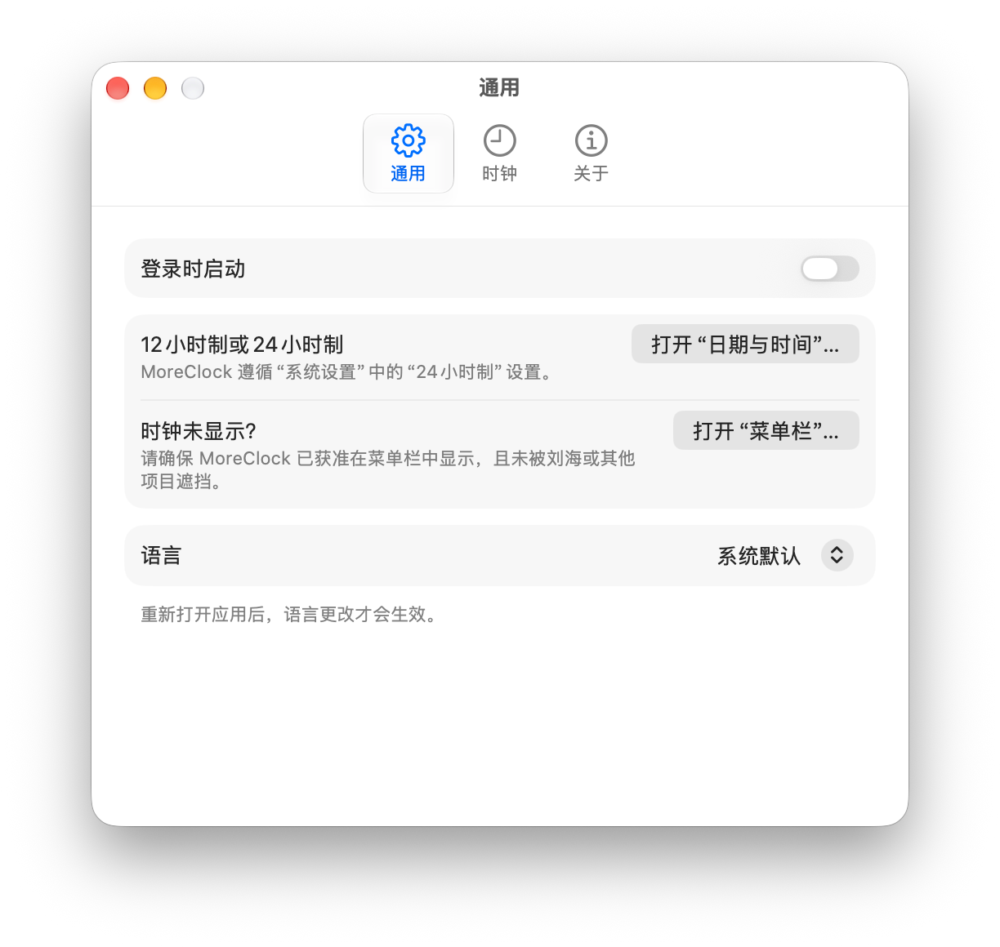
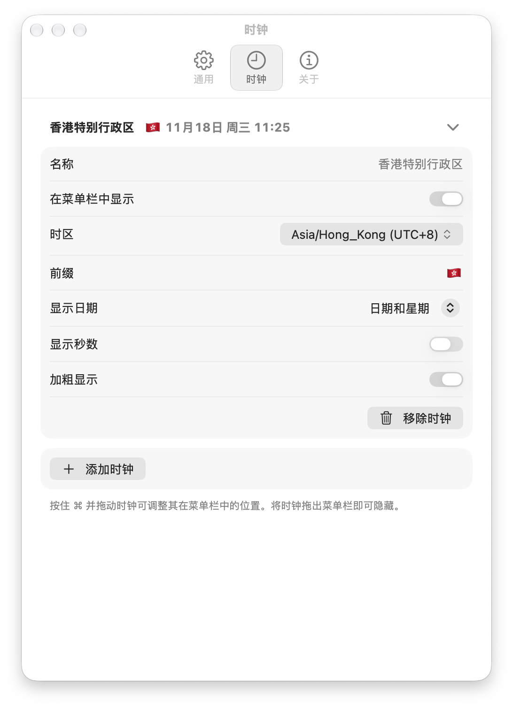

# MoreClock

[English](README.md)

为 macOS 菜单栏添加更多时钟，每个时区对应一个菜单栏项目。

## 应用截图


<p>
  
  
</p>

## 功能特性

- 时钟数量不限。每个时钟都有名称、独立的时区、前缀（例如国旗表情符号或“SF”）、可选的秒数、可选的加粗文字，以及可选的日期：星期、日期或两者都显示（“Tue”“Nov 17”“Tue, Nov 17”）。
- 日期会按用户的区域设置和日历格式化，并使用每个时钟各自的时区。檀香山的时钟与东京的时钟可以显示不同的日期。
- **名称**：时钟名称默认取搜索时选中的地点（“Kyoto”），否则取时区所在城市（“Tokyo”）或偏移量（“UTC+5”）。你也可以输入自定义名称（“妈妈”“柏林办公室”）。名称显示在“设置”、该时钟的菜单和“快捷指令”中；菜单栏显示的是前缀、日期和时间。
- **默认前缀**：选择城市或时区时，如果“前缀”为空，会自动填入对应国家或地区的旗帜。你已有的文字或表情符号会保留。UTC 和固定偏移量没有默认旗帜。
- 跟随系统的 12/24 小时制设置。
- 在每分钟刚过时更新。开启秒数的时钟每秒更新一次。
- 时区选择器：
  - 离线匹配城市、标识符、时区名称（“Pacific Time”）或偏移量（“UTC+5:30”）
  - MapKit 地点搜索（“Tokyo”“Norway”）
  - 香港和澳门会保留 `Asia/Hong_Kong` 和 `Asia/Macau`，即使“地图”将它们的地区报告为 `CN`、时区报告为 `Asia/Shanghai`。早先保存的、恰好存在这种城市与时区不匹配的时钟会在启动时修复，并保留其他设置。
  - 其他单一时区的地区使用各自的 IANA 标识符；多时区地区则沿用“地图”基于坐标得出的结果。
- 每个时钟的菜单会显示完整日期、UTC 偏移量、与本地时间的差值，以及“拷贝时间”和“隐藏此时钟”。
- 按住 ⌘ 拖动可重新排列时钟。将时钟拖出菜单栏即可隐藏。
- **设置**：三个工具栏标签页：通用（登录时启动、语言和系统设置链接）、时钟，以及关于（版本、构建号、提交、构建时间和 GitHub 链接）。所选标签页会被记住。每个时钟都有一个可折叠的分区（第一个默认展开）。移除时钟时会要求确认。
- “快捷指令”操作：添加、移除、显示/隐藏、设置名称、设置/获取时区、设置前缀、设置日期显示、获取时间。
- 已本地化为英语、简体中文和繁体中文、日语、韩语、德语、法语、西班牙语、意大利语、巴西葡萄牙语、俄语、阿拉伯语和波斯语，并支持阿拉伯语和波斯语的从右到左布局。
- 通过 `SMAppService` 实现登录时启动。

## 系统要求

- macOS 26 或更高版本
- Xcode 26 或更高版本。使用 Xcode 27.1 构建和测试。
- [XcodeGen](https://github.com/yonaskolb/XcodeGen)（`brew install xcodegen`）。`.xcodeproj` 由 `project.yml` 生成，因此请编辑 `project.yml` 并重新生成，而不要在 Xcode 中更改项目设置。

## 构建与运行

```bash
xcodegen generate
```

```bash
open MoreClock.xcodeproj
```

或者通过命令行：

```bash
xcodebuild -project MoreClock.xcodeproj -scheme MoreClock -derivedDataPath build/DerivedData build
```

```bash
open build/DerivedData/Build/Products/Debug/MoreClock.app
```

发布构建请使用该脚本。它会构建通用（universal）应用，并记录提交（有未提交的更改时标记为 `-dirty`）和构建时间，二者会显示在“设置 › 关于”中。其他构建只显示版本号和构建号。

```bash
Scripts/build-release.sh
```

应用没有 Dock 图标。首次启动时会打开“设置”。你可以随时从访达或聚焦再次打开应用来显示“设置”；如果所有时钟都被隐藏了，这就是返回设置的方法。

如果时钟没有出现，可能是被刘海或其他项目遮挡，也可能是被 macOS 隐藏了。请检查 **系统设置 › 菜单栏**（macOS 26 上）。

## 从 v0.1.0 升级

0.1.1 版本使用 Skyviiew 应用标识。因此，macOS 会为其分配独立的偏好设置域和沙盒容器。

若要保留你的时钟和应用语言，请在替换之前保留一份旧版 MoreClock 应用的副本。退出 MoreClock 的所有副本，然后以旧版应用和新版应用作为参数，运行设置迁移辅助脚本：

```bash
bash Scripts/migrate-settings.sh "/path/to/previous/MoreClock.app" "/Applications/MoreClock.app"
```

DMG 中也附带了该辅助脚本，名为 `Migrate Settings.sh`。它会通过 macOS 初始化新容器，将偏好设置备份到旧版应用的私有数据中，并在不删除旧偏好设置的前提下复制设置。如果新版应用中已经配置了不同的时钟，它会拒绝覆盖。如果应用已被替换，可以使用旧版本已挂载的 DMG 来提供旧版应用的路径。

如果你使用过“登录时启动”，请重新启用。现有的“快捷指令”可能需要更新，以使用新的应用标识。

## 测试

逻辑位于 `MoreClockKit` 包中，并使用 Swift Testing 测试：

```bash
swift test --package-path Packages/MoreClockKit
```

Xcode scheme 也会运行这些测试（⌘U，或 `xcodebuild … test -destination 'platform=macOS'`）。

## 本地化

- **语言控制**：“设置 › 通用 › 语言”使用原生的按应用 `AppleLanguages` 偏好设置，与 macOS“系统设置”共享。选择“系统默认”会移除应用的语言覆盖，并跟随系统语言。选择“立即重新打开”即可应用更改，“设置”将以新语言再次打开。在外部所做的更改会在 MoreClock 被激活时同步。
- **字符串目录**：字符串存放在两个 String Catalog 中：
  - `MoreClock/Resources/Localizable.xcstrings`：用于界面、菜单和“快捷指令”操作。
  - `MoreClock/Resources/AppShortcuts.xcstrings`：用于 Siri 和聚焦的短语。每个短语都必须包含 `${applicationName}`。
- **添加字符串**：在 SwiftUI 中使用字符串字面量，在其他位置使用 `String(localized:)` / `LocalizedStringResource`。然后在目录中添加对应的键，可以在 Xcode 中添加，也可以通过构建来提取新键。
- **格式化**：日期、时间和时长来自 Foundation 的格式样式，因此会遵循用户的区域设置、数字系统和日历。波斯语显示使用波斯数字的波斯历（Solar Hijri）日期。沙特阿拉伯的阿拉伯语显示乌姆库拉历（Umm al-Qura）日期。
- **字面输入**：在“快捷指令”的说明中，`System`、IANA 标识符和 `UTC+5:30` 有意保持英文。它们是这些操作接受的字面值。
- **测试某种语言**，无需更改系统语言：

  ```bash
  open build/DerivedData/Build/Products/Debug/MoreClock.app --args -AppleLanguages '(ar)'
  ```

## 应用图标

- **文件**：`MoreClock/Resources/AppIcon.icon` 是一个 Icon Composer 文件：冰蓝色渐变上的三个液态玻璃（Liquid Glass）时钟表盘。
- **外观**：它适配 macOS 26 的默认、深色、着色和透明外观。你可以在 Icon Composer（位于 Xcode 内）中打开并微调。
- **重新生成**：图层图稿由代码绘制。使用以下命令重新生成图层和 `Design/AppIcon/preview.png` 预览图：

  ```bash
  ./Design/AppIcon/render.sh
  ```

## 目录结构

```
project.yml                 XcodeGen 配置（target、Info.plist 键、entitlements、scheme）
Packages/MoreClockKit/      纯逻辑代码与测试
  ClockConfig.swift         时钟模型（Codable，容错解码）和 TimeZoneSelection
  ClockStore.swift          @Observable store，以 JSON 存储在 UserDefaults 的 "clocks" 键中
  ClockFormatter.swift      支持 12/24 小时制的标题、可选的日期部分、完整日期行、偏移量差值
  TimeZoneParsing.swift     "UTC+5:30" / 标识符 / 缩写、标签、离线搜索
MoreClock/
  App/                      AppKit 入口、app delegate、隐藏的主菜单（用于 ⌘C/⌘V）
  MenuBar/                  ClockTicker（对齐的定时器）和 StatusItemController（每个时钟一个菜单栏项目）
  Settings/                 设置窗口（SwiftUI Form）、登录时启动
  TimeZonePicker/           选择器弹出窗口和 MapKit 搜索
  Intents/                  App Intents、ClockEntity 和 App Shortcuts
  Resources/                String Catalog（Localizable、AppShortcuts）、AppIcon.icon
Design/AppIcon/             图标图层生成器（layers.swift）、渲染与预览脚本
```

## 发布前检查

- **应用标识**：bundle identifier 是 `com.skyviiew.MoreClock`，在 `project.yml` 中配置。偏好设置、沙盒存储、App Intents 以及按应用的语言设置都使用该标识。
- **签名**：本地和 GitHub 构建使用 ad-hoc 签名（`CODE_SIGN_IDENTITY: "-"`）。Developer ID 签名和 Apple 公证需要相应的签名证书和凭据。
- **地点搜索**：应用处于沙盒中，未启用 `com.apple.security.network.client`。请检查已签名的构建中地点搜索是否正常。如果不正常，请在 `project.yml` 中添加该 entitlement。
- **翻译**：发布前应由母语人士审校。这些翻译由机器起草并经机器审校。
